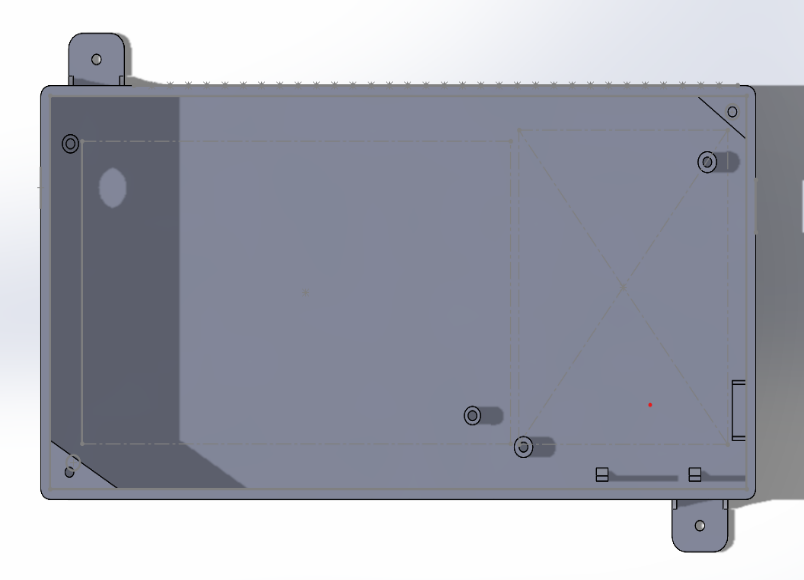
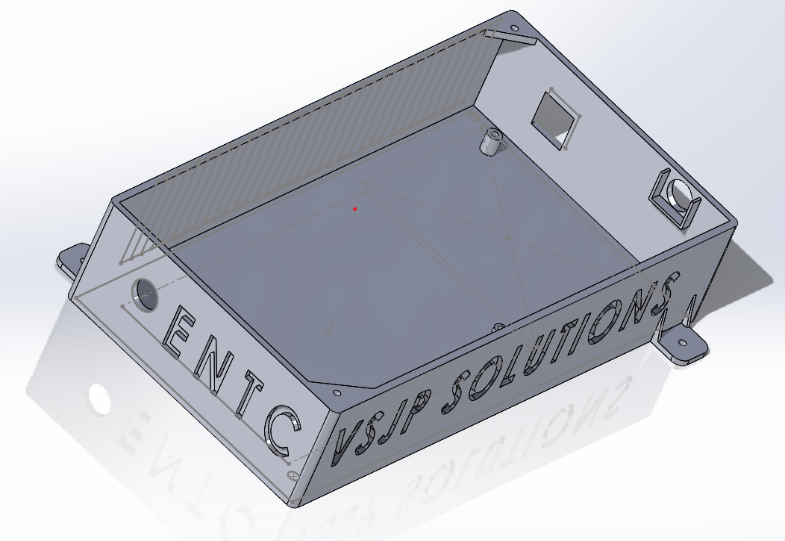
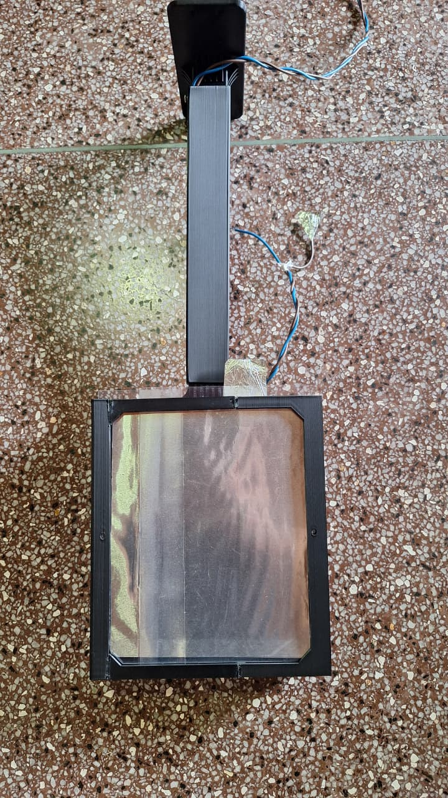
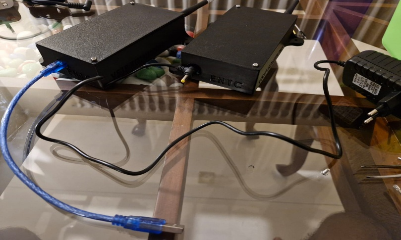
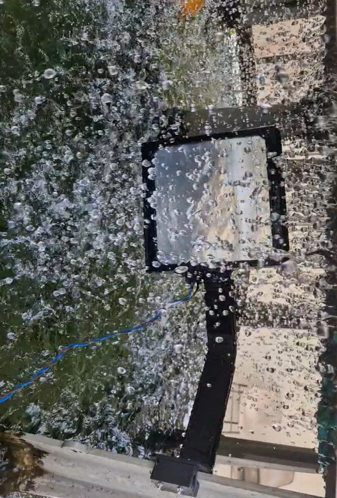

[← Back to README](../README.md)

# Enclosure Design for PCBs

## Enclosure Material – PETG (Polyethylene Terephthalate Glycol)

The 3D-printed enclosure is fabricated from PETG, a thermoplastic widely used in engineering FDM (Fused Deposition Modelling) applications. PETG was selected over common alternatives such as PLA and ABS due to the demanding outdoor rooftop environment in which the sensing module operates.

Key properties that make PETG suitable for this application:

- **Moisture & water resistance** – low moisture absorption with no warping or degradation under direct water spray exposure
- **UV resistance** – better outdoor longevity compared to PLA, important for rooftop installations with direct sunlight exposure
- **Temperature tolerance** – heat deflection temperature of approximately 70–80 °C, suitable for the elevated ambient temperatures expected on Sri Lankan rooftops
- **Mechanical toughness** – less brittle than PLA, providing adequate impact resistance to protect the internal electronics
- **Layer density** – PETG bonds well between print layers, producing a denser, more moisture-resistant enclosure than standard PLA prints

| Enclosure CAD – view 1 | Enclosure CAD – view 2 |
| :---: | :---: |
|  |  |

## Rooftop Enclosure

The Rooftop Enclosure houses both the Capacitance-to-Digital Converter (PCB 1) and the Sender/Receiver (PCB 2), mounted side by side on the same internal level. It is deployed outdoors at the rooftop alongside the cooling tower, where it is exposed to ambient heat, humidity, and occasional water spray. It is fabricated from PETG via FDM 3D printing, in line with the PETG material rationale described above.

The enclosure is wall-mounted using screw-and-bracket fasteners onto the nearest available wall surface adjacent to the cooling tower. Cable entry is provided through an open port, which accommodates the power supply cable from the 12 V DC adapter and the signal lines connecting to the capacitive sensing assembly. The lid is removable for maintenance access to both PCBs without full disassembly.

## Ground Station Enclosure

The Ground Station Enclosure houses the USB-interfacing electronics on the computer side of the system. It is wall-mounted near the operator's workstation, keeping the hardware tidy and protected while remaining within cable reach of the host computer's USB port. Since this enclosure operates indoors in a controlled environment, the environmental protection requirements are less stringent than for the Rooftop Enclosure.

It is similarly fabricated from PETG via FDM 3D printing and is designed to be compact, as it accommodates only the ground-side electronics. Cable routing is handled through an open port that accommodates the USB cable to the computer and any connecting lines to peripheral modules.

**Prototype photos**

| Sensor prototype | Assembled enclosures | Sensor under water spray |
| :---: | :---: | :---: |
|  |  |  |
