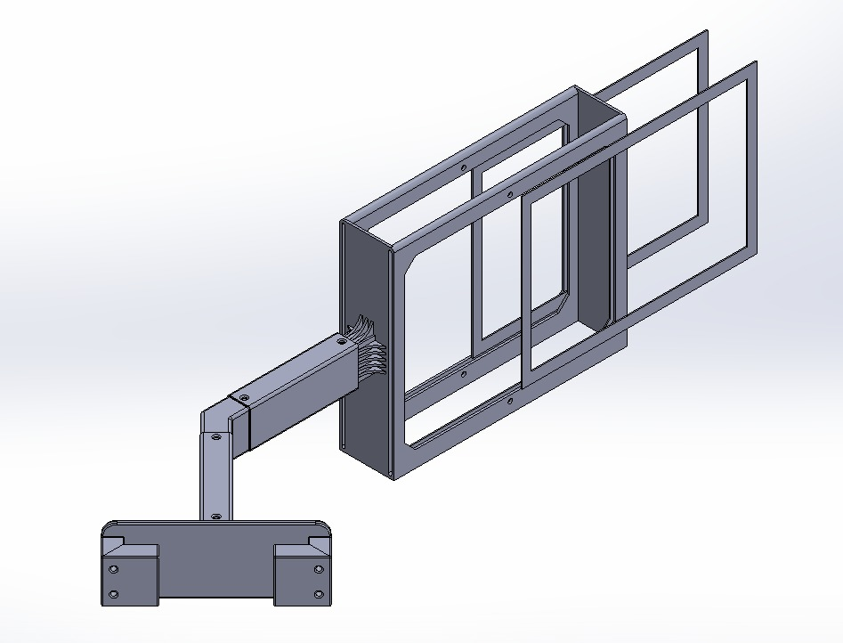
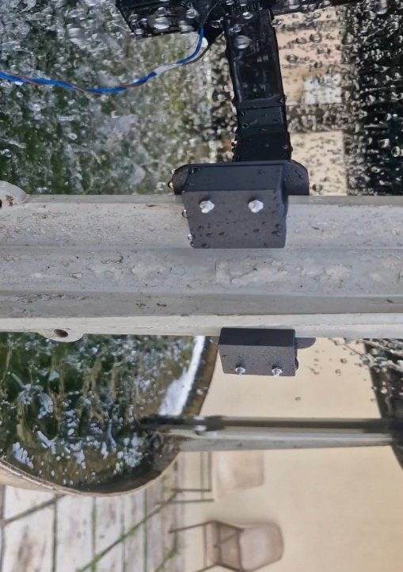

[← Back to README](../README.md)

# Free Flow Sensor

## Novel Free Flow Sensing Mechanism

The capacitance-based free-flow sensing mechanism is based on the variation of effective permittivity in the sensing region between two electrodes as a mixture of air and water flows through it. The capacitance of the sensor is:

$$C = \frac{\varepsilon_{eff} \, A}{d}$$

where *A* is the effective electrode area, *d* is the separation between electrodes, and *εeff* is the effective permittivity of the medium, defined as *εeff = ε0 εr*, where *εr* depends on the material present in the sensing region. Since air has a relative permittivity close to 1 and water has a much higher value (approximately 80), the overall capacitance increases as the fraction of water in the sensing region increases. This behaviour can be approximated using a volume fraction model:

$$\varepsilon_{eff} = \varepsilon_{air}(1 - \alpha) + \varepsilon_{water}\,\alpha$$

where *α* is the volume fraction of water in the sensing region.

The capacitance variation is converted into a frequency signal by an oscillator circuit built around a 555 timer, where the sensor acts as part of the timing network. For an RC-based oscillator, the output frequency is inversely proportional to the capacitance:

$$f = \frac{k}{R \, C}$$

where *R* is a fixed resistance and *C* is the sensor capacitance. As the water content increases, the capacitance increases and the output frequency decreases, whereas lower water content results in a higher frequency. The microcontroller measures this frequency by pulse counting over a fixed time interval:

$$f = \frac{N}{T}$$

where *N* is the number of pulses counted during time *T*. After proper calibration, this frequency variation can be mapped to the corresponding flow condition, enabling real-time monitoring of free-flow behaviour and liquid occupancy within the sensing region.

## Mechanical Structure and Mounting of the Capacitance-Based Free Flow Sensing System

The figure below illustrates the mechanical assembly designed for positioning and supporting the capacitance-based free-flow sensing module. The system consists of a rigid base platform that provides structural stability and acts as the mounting point for a multi-link articulated arm mechanism. The arm is constructed from two main rigid links connected through a joint.

  
  

The distal end of the arm supports a rectangular frame structure, which serves as the mounting enclosure for the sensing element. This frame holds the electrode configuration required for capacitive measurement while maintaining mechanical rigidity and alignment with the flow region. The open-frame architecture keeps the sensing region exposed to the surrounding medium, allowing interaction with the fluid without obstruction. The articulated arm enables precise placement of the sensing frame within the target measurement zone, ensuring repeatable positioning and stable operation during experimental or real-time flow monitoring.

| Sensor enclosure (CAD) | Sensor mounted on site |
| :---: | :---: |
|| |

The capacitance-based sensing module is designed to be mounted directly onto the existing mechanical structure of the cooling tower without requiring any permanent modification, drilling, or alteration to the original installation. This non-destructive mounting approach allows the system to be retrofitted onto any compatible cooling tower structure with minimal installation effort and without voiding structural warranties or maintenance agreements.

The sensing assembly is housed within a custom 3D-printed enclosure, designed to hold the two parallel capacitive plates in precise opposition across the water flow path. The enclosure is secured to the cooling tower's structural pole or frame using a pole-clamp style bracket, where bolts and clamps grip the existing pole on both sides.

To ensure long-term use of the aluminium plates, a **nano ceramic coating** is applied over the laminated aluminium plates, giving an expected lifetime of more than 1 year before replacement. The capacitive plates are mounted to the plastic structure in a way that makes replacement simple and easy.

*Dimensions annotated on the original drawing: 30 mm, 150 mm, 75 mm.*
