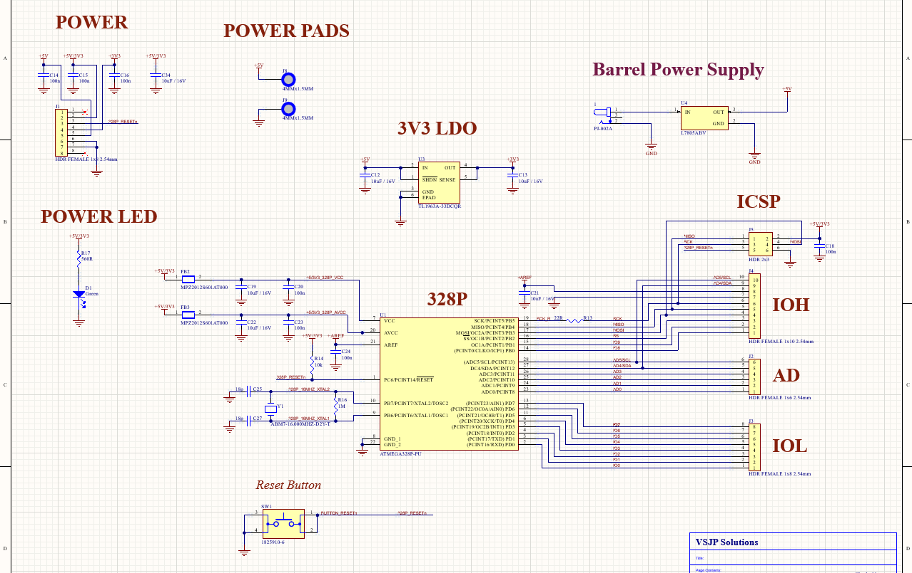
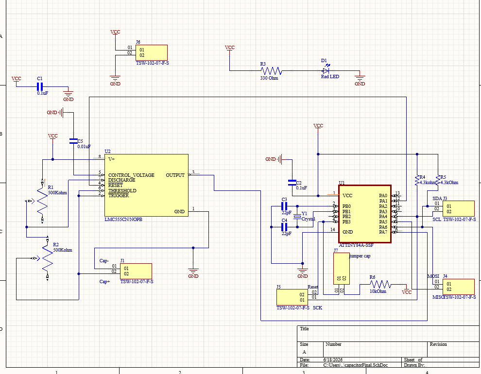
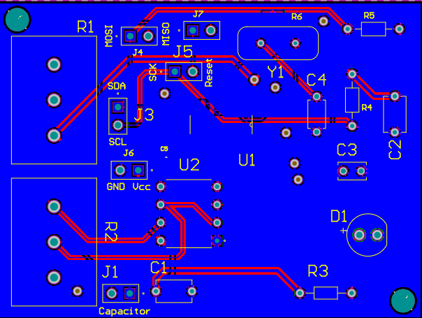
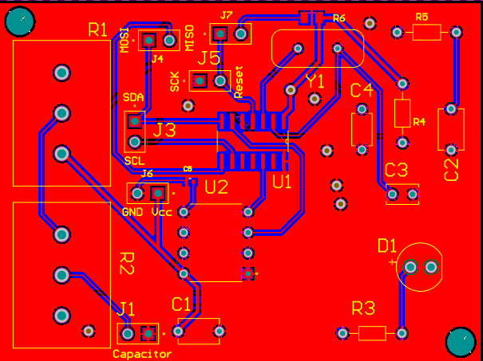
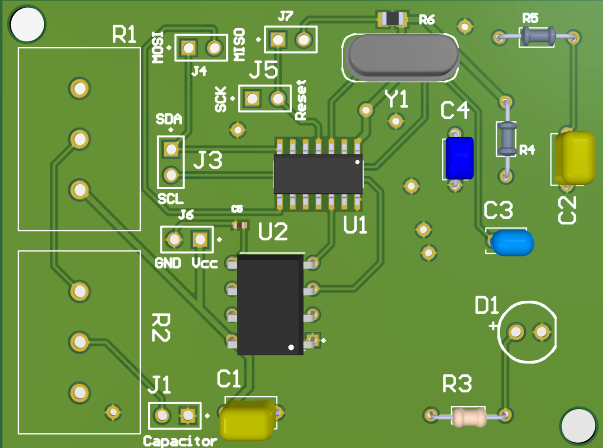
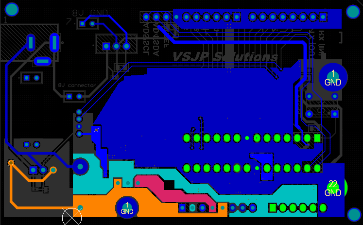
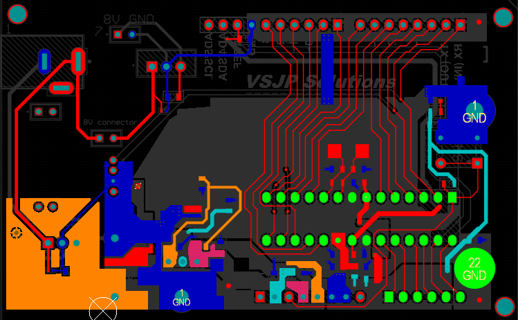
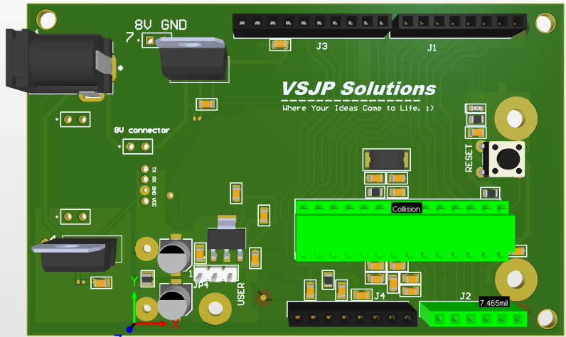

[← Back to README](../README.md)

# Hardware Design

## Circuit Schematic

**Sender/Receiver (PCB 2)**

  

**Capacitance to Digital Converter (PCB 1)**

  

## Component List (Bill of Materials)

The hardware modules purchased for the project include two LoRa SX1278 communication modules for wireless data transmission, an FT232RL USB-to-TTL converter for serial communication between the software dashboard and the sender module, a 4-channel bi-directional logic level shifter to ensure compatibility between different voltage levels (3.3 V and 5 V), and a 12 V barrel power supply to provide the required operating power for the system components.

A Solid-State Relay (SSR) is used to safely control an AC power line using a low-voltage 5 V logic signal from a microcontroller. The 5 V control signal activates the SSR, which internally provides electrical isolation and switches the high-voltage AC load without requiring any mechanical contacts. This arrangement enables reliable and noise-free operation while protecting the low-voltage control circuitry from the mains supply. Consequently, the microcontroller can safely turn AC-powered devices, such as motors or pumps, ON and OFF through simple digital control signals.

### Sender/Receiver PCB 2

| Ref | Manufacturer Part No. | Description | Manufacturer | Value | Footprint | Qty |
| --- | --- | --- | --- | --- | --- | --- |
| **CONNECTORS** | | | | | | |
| 2, 3, 7, Connector1 | SAM10844-ND | Conn Header Vert 2Pos 2.54mm | Samtec Inc. | — | SAMTEC_TSW-102-07-F-S | 4 |
| 1 | PJ002AH | DC Power Jack, 2.0×6.5mm, 2.5A, Through Hole | Same Sky (CUI Devices) | — | CUI_PJ-002A | 1 |
| J3 | M20-7821046 | Conn Rcpt 10Pos 0.1 Tin PCB | Harwin Inc. | — | Hdr_Female_1x10_2.54mm | 1 |
| J4, J5 | M20-7820842 | Conn Rcpt 8Pos 0.1 Gold PCB | Harwin Inc. | — | Hdr_Female_1x8_2.54mm | 2 |
| J6 | M20-7820646 | Conn Rcpt 6Pos 0.1 Tin PCB | Harwin Inc. | — | Hdr_Female_1x6_2.54mm | 1 |
| JP1 | 68000-103HLF | Conn Header Vert 3Pos 2.54mm | Amphenol ICC (FCI) | — | Hdr_1x3_2.54mm | 1 |
| **CAPACITORS** | | | | | | |
| C4, C6, C8, C9, C10, C13, C15, C16, C20, 6, 10 | C2012X7R1H104K085AA | Cap Cer 0.1uF 50V X7R 0805 | TDK | 0.1uF | C0805 | 11 |
| C3, C5, C7, C12, C17, C18 | CGA4J1X5R1C106M125AC | Cap Cer 10uF 16V X5R 0805 | TDK | 10uF | C0805_-_1.45HEIGHT | 6 |
| C1, C2 | EEE-1AA101WR | Aluminium Electrolytic Cap, 100uF 10V ±20%, Radial SMD | Panasonic | 100uF | C_ALU_C_SIZE | 2 |
| C11, C14 | C0805C180J5GACTU | Cap Cer 18pF 50V C0G/NP0 0805 | KEMET | 18pF | C0805_-_1.45HEIGHT | 2 |
| 5, 9 | CGA2B1X7S1C334K050BC | Cap Cer 0.33uF 16V X7S 0402 | TDK | 0.33uF | CAPC1005X55N | 2 |
| **RESISTORS** | | | | | | |
| R1 | RC0805JR-070RL | Res 0 Ohm Jumper 1/8W 0805 | YAGEO | 0Ω | R0805 | 1 |
| R2 | RC0805FR-071ML | Res 1M Ohm 1% 1/8W 0805 | YAGEO | 1MΩ | R0805 | 1 |
| R3 | RC0805FR-07560RL | Res 560 Ohm 1% 1/8W 0805 | YAGEO | 560Ω | R0805 | 1 |
| R4 | RC0805FR-0710KL | Res 10K Ohm 1% 1/8W 0805 | YAGEO | 10kΩ | R0805 | 1 |
| **INTEGRATED CIRCUITS** | | | | | | |
| 4 | L7805ABV | IC Reg Linear 5V 1.5A TO220 | STMicroelectronics | 5V | TO254P460X1020X1945-3P | 1 |
| 8 | L7808ACV | IC Reg Linear 8V 1.5A TO220 | STMicroelectronics | 8V | TO225P1020X450X1935-3 | 1 |
| U1 | SOT229P700X180-4N | IC Reg Linear 3.3V 1.5A SOT-223-6 | Texas Instruments | 3.3V | GCQ_(R-PDSO-G6) | 1 |
| U2 | ATMEGA328P-PU | IC MCU 8-Bit 32KB Flash 28DIP | Microchip Technology | — | 28_DIP_7.62MM | 1 |
| **INDUCTORS & FERRITE BEADS** | | | | | | |
| L1 | DFE201610P-2R2M=P2 | Fixed Inductor 2.2uH 2A 168mΩ SMD | Murata Electronics | 2.2uH | 2016_IND | 1 |
| FB1, FB2 | MPZ2012S601AT000 | Ferrite Bead 600 Ohm 0805 | TDK | 600Ω | C0805 | 2 |
| **DISCRETE COMPONENTS** | | | | | | |
| D1 | APT1608LZGCK | LED Green 525nm 2.65V 0603 | Kingbright | Green | LED_0603 | 1 |
| SW1 | 1825910-6 | Switch Tactile SPST-NO 0.05A 24V | TE Connectivity | — | 1825910-6 | 1 |
| Y1 | ABM7-16.000MHZ-D2Y-T | Crystal 16.0000MHz 18pF SMD | Abracon LLC | 16MHz | ABM7_v1_1_big | 1 |

### Capacitance to Digital Converter PCB 1

| Ref | Manufacturer Part No. | Description | Manufacturer | Value | Footprint | Qty |
| --- | --- | --- | --- | --- | --- | --- |
| **CONNECTORS** | | | | | | |
| J1, J2, J3, J4, J5, J6, J7, J8 | TSW-102-07-F-S | Conn Header Vert 2Pos 2.54mm | Samtec Inc. | — | SAMTEC_TSW-102-07-F-S | 8 |
| **CAPACITORS** | | | | | | |
| C1, C2 | SR211C104KARTR1 | Cap Cer 0.1uF 100V X7R Radial | KYOCERA AVX | 0.1uF | CAPRR508W50L508T317H508 | 2 |
| C3 | FG18C0G1H220JNT00 | Cap Cer 22pF ±5% 50V C0G/NP0 Radial | TDK Corporation | 22pF | CAPRB250W50L400T250H550 | 1 |
| C4 | FA28NP01H220JNU06 | Cap Cer 22pF ±5% 50V C0G/NP0 Radial | TDK Corporation | 22pF | CAPRB500W50L400T250H550 | 1 |
| C5 | GRM155R71C103KA01D | Cap Cer 10000pF 16V X7R 0402 | Murata Electronics | 0.01uF | CAPC1005X55N | 1 |
| **RESISTORS** | | | | | | |
| R1, R2 | PDB181-K420K-504A2 | Potentiometer 500kΩ 1-Gang Linear, 0.2W, Panel Mount, PC Pins | Bourns | 500kΩ | P160 | 2 |
| R3 | CFM12JT330R | Res 330 Ohm 5% 1/2W Axial | Stackpole Electronics | 330Ω | RESAD730W45L360D200 | 1 |
| R4, R5 | MFR-12FTF52-4K3 | Res 4.3K Ohm 1% 1/6W Axial | YAGEO | 4.3kΩ | RESAD730W45L370D210 | 2 |
| R6 | CRT0805-FZ-1002ELF | Res Thin Film 10kΩ ±1% 0.125W 0805 | Bourns | 10kΩ | RESC2012X65N | 1 |
| **INTEGRATED CIRCUITS** | | | | | | |
| U1 | ATTINY84A-SSF | IC MCU 8-Bit 8KB Flash 14SOIC | Microchip Technology | — | SOIC127P600X175-14N | 1 |
| U2 | LMC555CN/NOPB | IC Osc Single Timer 3MHz 8-DIP | Texas Instruments | — | DIP794W45P254L959H508Q8 | 1 |
| **DISCRETE COMPONENTS** | | | | | | |
| D1 | 151051RS11000 | LED Red Diffused 5mm Round T/H | Würth Elektronik | Red | WL-TMRC_5MM | 1 |
| Y1 | ECS-160-20-4X | Crystal 16.0000MHz 20pF T/H | ECS Inc. | 16MHz | XTAL_ECS-160-20-4X | 1 |

## PCB Design

### PCB Layout

**Capacitance to Digital Converter (PCB 1)**

| Bottom Layer | Top Layer | 3D Layout |
| :---: | :---: | :---: |
|  |  |  |

**Sender/Receiver (PCB 2)**

| Bottom Layer | Top Layer | 3D Layout |
| :---: | :---: | :---: |
|  |  |  |

### PCB Specifications

**PCB 1**

| Parameter | Value |
| --- | --- |
| Board Dimensions | 60 mm × 45 mm |
| Number of Layers | 2 |
| Copper Weight | 1 oz |
| Board Material | FR-4 |
| Surface Finish | HASL (with lead) |
| Min. Track Width | 0.254 mm |
| Min. Via Drill | 0.3 mm |

**PCB 2**

| Parameter | Value |
| --- | --- |
| Board Dimensions | 92.4 mm × 57.6 mm |
| Number of Layers | 2 |
| Copper Weight | 1 oz |
| Board Material | FR-4 |
| Surface Finish | HASL (with lead) |
| Min. Track Width | 0.299 mm |
| Min. Via Drill | 0.3 mm |
