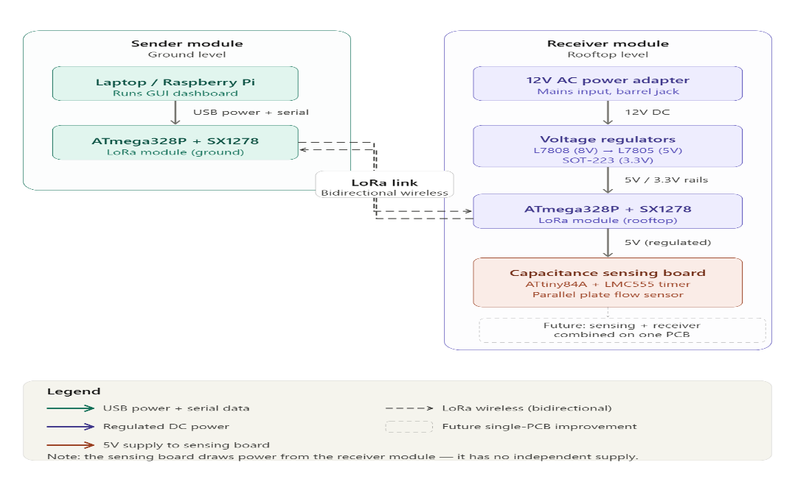

[← Back to README](../README.md)

# Power Supply Design

## Power Architecture

The system comprises two physically separated controller units, a **Sender (Ground) Module** and a **Receiver (Rooftop) Module**, each with an independent power source suited to its deployment environment.

The **Sender Module** is powered directly via USB from the host computer running the software dashboard. This may be a standard laptop or a single-board computer such as a Raspberry Pi. This arrangement eliminates the need for a dedicated power supply at the ground station, as the USB connection simultaneously powers the ATmega328P-based controller and provides the serial communication interface to the dashboard software.

The **Receiver Module**, deployed at the rooftop alongside the cooling tower, is powered by a 12 V DC supply derived from a mains AC power adapter (barrel jack input). The onboard voltage regulators (L7808 and L7805) step this down to the 8 V and 5 V rails required by the microcontroller and peripheral circuits. The capacitance-based flow sensing circuit (ATtiny84A + LMC555 timer board) draws its operating power directly from the Receiver Module's regulated 5 V rail and is therefore not independently powered.

> **Design Note:** In the current prototype, the Receiver Module and the flow sensing circuit are implemented on two separate PCBs for flexibility during development and testing. As a planned improvement, these two circuits are intended to be integrated onto a single PCB in a future revision, reducing wiring complexity, connector count, and overall form factor.

  

## Power Budget

| Subsystem | Current (mA) | Power (mW) |
| --- | --- | --- |
| Microcontrollers | 139 mA | 453 mW × 2 |
| Sensors | 15 mA | 74 mW |
| **Total** | **154 mA** | **980 mW** |
