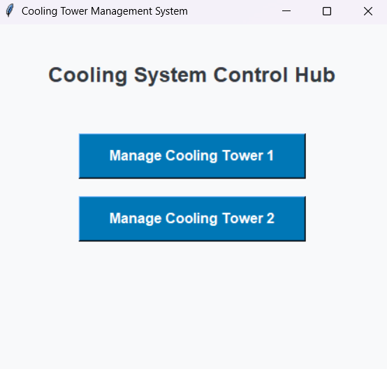
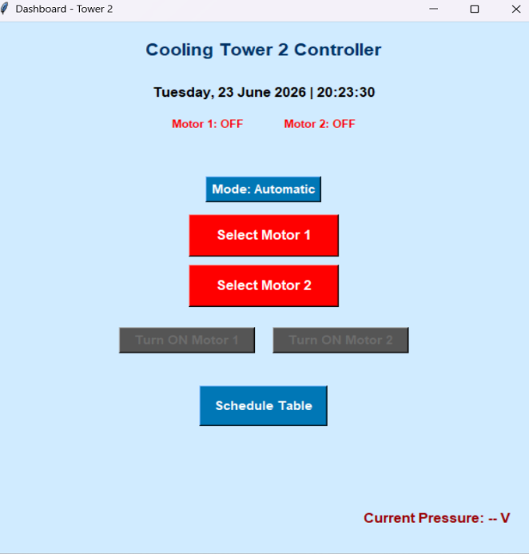
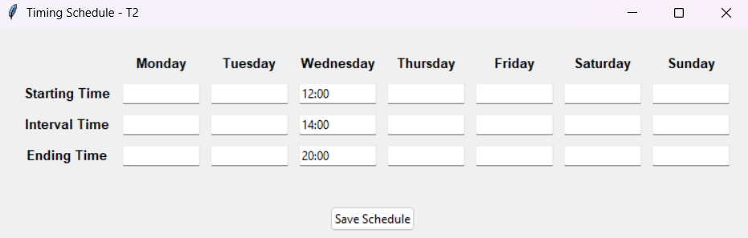

[← Back to README](../README.md)

# Software Design

## User Interface

For demonstration purposes, the system automates a single cooling tower through a simple graphical user interface (GUI). The architecture is scalable: if automation of multiple cooling towers is required, additional receiver modules can be deployed. The dashboard below illustrates an implementation capable of monitoring and controlling two cooling towers simultaneously.

| Main Hub | Tower Controller |
| :---: | :---: |
|  |  |

**Weekly timing schedule**

  

## Development Environment

| Tool / Environment | Details |
| --- | --- |
| Programming Language | Python, C++ |
| IDE / Editor | Arduino IDE, Thonny |
| Libraries Used | Python – Tkinter; LoRa by Sandeep Mistry |
