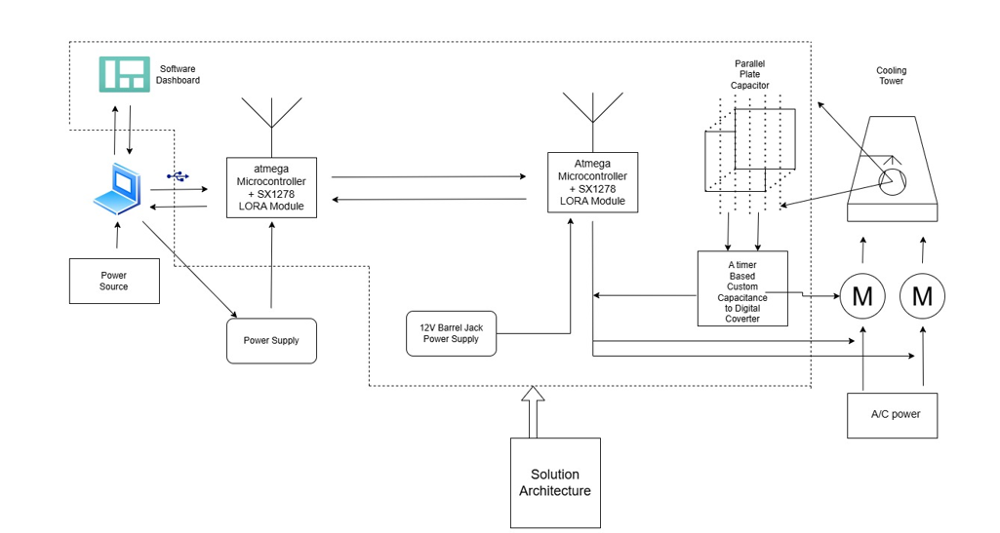

[← Back to README](../README.md)

# System Design

## System Architecture

  

## Design Requirements

### Functional Requirements

- The system includes two subsystems, the **Sender** and **Receiver(s)**, with frequent communication between them using LoRa nodes. The system shall communicate over a distance of roughly 500 m.
- The novel flow-sensing mechanism shall measure a frequency deviation over changes in free flow, and the flow condition can be measured in up to 3 steps.
- The software dashboard shall run on a computer or laptop (preferred).

### Non-Functional Requirements

- The enclosures and all hardware shall be dust and water resistant (**IP54**). When mounting the system, make sure it is well protected.
- The distance between the sender and the receiver must not exceed 840 m.
- The time period between two consecutive commands shall not be less than 2.5 s.

## Design Decisions & Rationale

### Communication Protocol – LoRa (SX1278)

A key challenge was establishing reliable wireless communication between the ground-level control unit and the rooftop-mounted cooling tower unit. Wi-Fi and Bluetooth were considered but ruled out due to their limited range and poor performance through concrete walls and building structures. LoRa (Long Range) communication using the SX1278 module was selected because it provides long-range, low-power data transmission and handles obstacles and interference effectively, making it well suited for building environments where the two controller nodes may be separated by significant distance and physical barriers.

### Novel Flow Sensing Method – Capacitance-Based Free Flow Detection

Conventional flow sensors such as turbine-type or ultrasonic flow meters were considered for detecting pipe blockages caused by algae buildup. However, these options were either invasive (requiring pipe modifications) or significantly more expensive. A custom capacitance-based free-flow sensing approach using parallel plates was designed instead. As water flows between the plates, the effective dielectric constant changes, producing a measurable variation in capacitance. This provides a non-invasive, cost-effective, real-time method for flow detection without major hardware changes.

### Capacitance-to-Frequency Conversion – 555 Timer

Three circuit approaches were evaluated for converting the capacitance change into a readable signal. The 555 timer-based approach was ultimately selected as the final design. By relating the capacitance to the discharge time (`T = K × R₂ × C`) and controlling the measurement interval, the circuit produces a stable frequency output that decreases as water flow rate increases. This approach offers improved noise immunity, easier tuning via variable resistors, and direct compatibility with the microcontroller for digital signal processing.

### Microcontroller Integration – ATmega with LoRa Module

Rather than using a PLC (Programmable Logic Controller), the conventional choice for industrial cooling tower control, an ATmega microcontroller paired with the SX1278 LoRa module was chosen for both the ground and rooftop units. PLC-based systems combined with pressure transducers would have significantly increased implementation cost. The ATmega offers adequate processing capability for this application at a fraction of the cost, while also enabling direct digital processing of the capacitance sensor signal and seamless integration with the LoRa communication module.

### Control Interface – Python GUI Dashboard

A software dashboard built with Python's Tkinter library was developed as the central control interface. It provides operators with real-time water flow status, automatic and manual operating modes, a weekly time-scheduling table, and live pressure/flow readings, all from a ground-level workstation. This eliminates the need for physical rooftop access for routine operation and monitoring, directly addressing one of the key problems identified during stakeholder validation.
