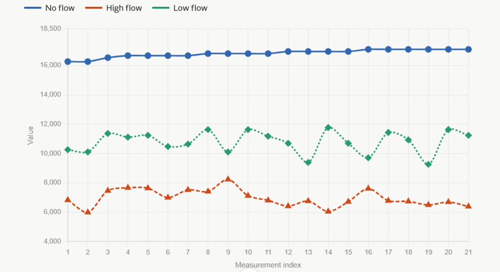

[← Back to README](../README.md)

# Testing & Validation

## Test Plan

The product has two main processes: reading the free-flow sensor and the LoRa network. To test the flow sensor, the approach was to measure flow at 3 levels (high flow, medium flow, and no flow) and observe the change in frequency output. The LoRa network was tested using the dashboard, with the two units kept within a distance of 1 km at randomly chosen locations.

## Test Results

| ID | Test Case | Expected Result | Actual Result | Status |
| --- | --- | --- | --- | --- |
| TC-01 | LoRa network (kept closer) | Worked | xxxxxxxxxxxxxx | ✔ Pass |
| TC-02 | LoRa network (at distance of 300 m) | Worked | xxxxxxxxxxxxxx | ✔ Pass |
| TC-03 | Novel flow sensor | Increased flow → decreased frequency | Actual result is same as the expected result | ✔ Pass |

## Performance Measurements

Although the proposed capacitive flow-sensing mechanism does not provide the same sensitivity as a conventional pressure transducer, it demonstrates sufficient performance for the intended application. Pressure transducers are designed to detect minute pressure variations with high precision, making them suitable for applications requiring continuous and highly accurate flow measurements. In contrast, the proposed sensor focuses on detecting changes in free-flow conditions at predefined intervals, allowing it to reliably identify variations in flow behaviour rather than absolute pressure values.

Experimental evaluations indicate that the sensor can measure changes in free flow with a satisfactory degree of accuracy at selected measurement gaps. This is adequate for the system's operational requirements, where the primary objective is to monitor the presence and progression of free flow rather than perform high-resolution pressure analysis. The proposed sensing approach therefore offers a practical balance between measurement capability, implementation complexity, and cost, making it well suited for the target application while maintaining reliable and repeatable performance.

  

