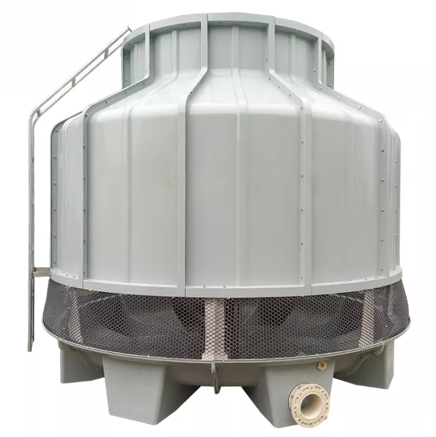

# Water Cooling Tower Automation System

**Team VSJP Solutions** · University of Moratuwa, Faculty of Engineering

Electronic Product Design – Engineering Design Project
Department of ENTC · Academic Year 2025 / 2026

A low-cost, wireless, non-invasive retrofit automation system for industrial air-conditioning water cooling towers. It uses a LoRa (SX1278) link between a ground-level dashboard and a rooftop unit, and a novel capacitance-based free-flow sensor to detect pipe blockages caused by algae buildup.

| Team Member | Registration Number |
| --- | --- |
| Kumarasinghe K.A.D.V. | 240367 U |
| Lochana K.A.S. | 240396 G |
| Lasantha L.H.J.D. | 240384 T |
| Liyanage B.L.D.P.T.G. | 240391 L |

**Submitted to:** Dr. A. Pasqual
**Date:** 4th July 2026

---

---

## Introduction

This project focuses on automating the control of industrial air-conditioning water cooling towers at a considerably low cost, with a decent level of reliability. These towers are typically operated manually and require personnel to switch them ON and OFF. Over time, algae buildup can block water lines, causing the motors to run without adequate water and leading to damage. To prevent unnoticed failures, the proposed system incorporates an alarm mechanism that alerts technical personnel when abnormal conditions are detected.

## Project Objectives

- **Objective 1** – Automated control
- **Objective 2** – Error handling

## Scope

The current deployment focuses only on the data handling layer of the system, so its functionality is limited to signal acquisition, transmission, and error processing. Direct interfacing with the actual cooling tower motors and other high-power equipment is not included at this stage. The implemented prototype therefore serves as a monitoring and communication platform, while the integration of motor control hardware and field devices is left for future development.

## Team Roles & Responsibilities

| Name | Reg. No. | Primary Responsibility |
| --- | --- | --- |
| Kumarasinghe K.A.D.V. | 240367 U | Idea generation, system architecture design, PCB design |
| Lochana K.A.S. | 240396 G | Team leader, designed the novel flow-measuring sensor, enclosure design |
| Lasantha L.H.J.D. | 240384 T | Enclosure design, PCB design |
| Liyanage B.L.D.P.T.G. | 240391 L | Enclosure design, PCB design |

---

## Documentation

| Document | Contents |
| --- | --- |
| [System Design](docs/system-design.md) | Architecture, functional / non-functional requirements, design decisions & rationale |
| [Hardware Design](docs/hardware-design.md) | Schematics, bill of materials, PCB layouts and specifications |
| [Software Design](docs/software-design.md) | Python dashboard, development environment |
| [Power Supply Design](docs/power-supply.md) | Power architecture and power budget |
| [Free Flow Sensor](docs/flow-sensor.md) | Capacitance-based sensing theory, mechanical structure and mounting |
| [Enclosures](docs/enclosures.md) | PETG material rationale, rooftop and ground-station enclosures |
| [Testing & Validation](docs/testing-validation.md) | Test plan, results, sensor performance |
| [Safety & Compliance](docs/safety-compliance.md) | Hazard analysis and applicable standards |
| [Results & Future Work](docs/results-and-future-work.md) | Summary of results, discussion, planned improvements |

---

**VSJP Solutions** · Team: 240367U, 240396G, 240384T, 240391L

